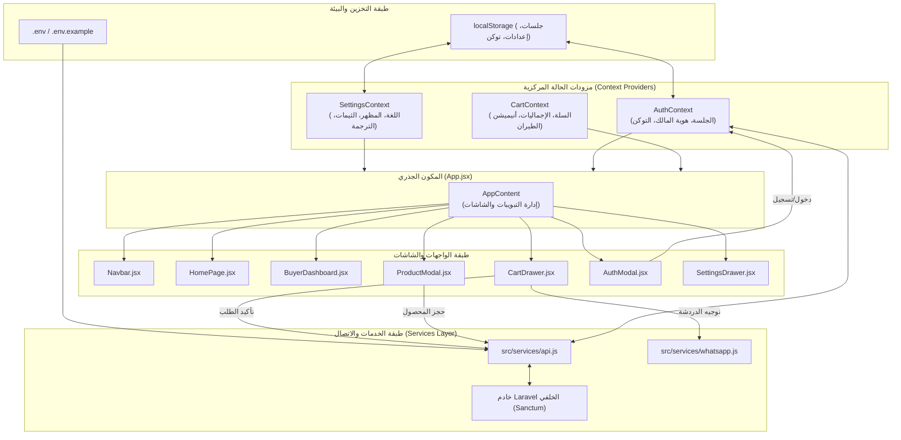

# الدليل الهندسي الشامل: الهيكلية وخريطة الملفات وتدفق البيانات
# Architecture, File Map & Data Flow

يوثق هذا الدليل الهيكلية المعمارية لمنصة **AgriMarket**، وخريطة المجلدات والملفات الفعلية داخل `src/`، مع شرح تفصيلي لتدفق البيانات (Data Flow) بين المكونات والسياقات، وطبقة الاتصال بالخادم، وآلية التبديل السلس بين الوضع التجريبي والحي (Mock / Live Switch)، وهندسة الطبقات وزوايا العرض لمنع تداخل الواجهات.

---

## 1. شجرة مجلدات وملفات المشروع الفعلية (File Tree)

```text
agritech-coffee-web/
├── docs/                                 # مجلد التوثيق والعقود والمراجع
│   ├── guide/                            # الدليل الهندسي والتعليمي الشامل للمشروع
│   │   ├── README.md                     # فهرس وبوابة الدليل الشامل
│   │   ├── 01_ARCHITECTURE_AND_FILES.md  # هذا الملف (الهيكلية وتدفق البيانات)
│   │   ├── 02_DESIGN_AND_ANIMATIONS.md   # دليل التصميم ونظام الحركة
│   │   ├── 03_EDITING_COOKBOOK.md        # كتاب الطبخ للتعديل السريع وحل المشكلات
│   │   └── 04_REUSABLE_PLAYBOOK.md       # وصفة بناء أي مشروع مستقبلي
│   └── AgriTech_Web_API_v1.0.yaml        # العقد الملزم لمسارات وحقول خادم Laravel (OpenAPI 3.1)
├── public/                               # الملفات الثابتة المباشرة
│   ├── favicon.svg                       # أيقونة المتصفح الرسمية للمنصة
│   └── images/                           # صور المحاصيل التجريبية
├── src/                                  # الكود المصدري للتطبيق
│   ├── assets/                           # الأصول المرئية الثابتة
│   │   ├── hero.png                      # صورة توضيحية لمنتجات المنصة
│   │   ├── react.svg                     # شعار React الافتراضي
│   │   └── vite.svg                      # شعار Vite الافتراضي
│   ├── components/                       # مكونات واجهة المستخدم
│   │   ├── common/                       # المكونات المشتركة العامة
│   │   │   ├── BrandLogo.jsx             # الشعار الموحد للمنصة (أيقونة Sprout + نص AgriMarket)
│   │   │   ├── FloatingActions.jsx       # الأزرار العائمة (دعم واتساب الفوري والعودة للأعلى)
│   │   │   ├── FlyToCartOverlay.jsx      # طبقة أنيميشن طيران المنتج نحو السلة
│   │   │   └── GlobalInteractiveBackground.jsx # الخلفية الفيزيائية التفاعلية الشاملة
│   │   ├── home/                         # مكونات الصفحة الرئيسية والمتجر
│   │   │   ├── AppDownloadBanner.jsx     # شريط تحميل التطبيق الزراعي
│   │   │   ├── CategoryFilters.jsx       # شريط فلاتر التصنيف، البحث، والترتيب
│   │   │   ├── Hero.jsx                  # الواجهة الترحيبية وهاتف العرض ثلاثي الأبعاد
│   │   │   ├── HeroAmbientBackground.jsx # خلفية التوهج الزمردي الهادئ للـ Hero
│   │   │   ├── HeroParticlesBackground.jsx # خلفية الجزيئات الفيزيائية للـ Hero
│   │   │   ├── PlatformFeaturesSection.jsx # قسم مميزات المنصة الرقمية المتكاملة
│   │   │   ├── Product3DShowcase.jsx     # كيس البن ثلاثي الأبعاد (Three.js / Fiber)
│   │   │   ├── ProductCard.jsx           # بطاقة عرض المحصول الفردية في المتجر
│   │   │   └── TrustAndFaqSection.jsx    # قسم التقييمات المعتمدة والأسئلة الشائعة
│   │   ├── layout/                       # الهياكل الإطارية الثابتة
│   │   │   ├── Footer.jsx                # التذييل السفلي وروابط الدعم والتواصل
│   │   │   ├── Navbar.jsx                # الشريط العلوي الزجاجي الثابت وأدوات التحكم
│   │   │   └── TabLoader.jsx             # مؤشر التحميل والانتقال السلس بين الشاشات
│   │   └── modals/                       # النوافذ المنبثقة والقوائم الجانبية
│   │       ├── AuthModal.jsx             # نافذة تسجيل الدخول وإنشاء الحساب (Portal z-120)
│   │       ├── CartDrawer.jsx            # لوحة السلة الجانبية المنزلقة وتأكيد الطلب
│   │       ├── FarmersModal.jsx          # نافذة خدمة المزارعين والتعاونيات الزراعية
│   │       ├── ProductModal.jsx          # نافذة تفاصيل المحصول المنبثقة (Portal z-100)
│   │       └── SettingsDrawer.jsx        # درج إعدادات المظهر والمنصة وثيمات المالك
│   ├── config/                           # ملفات الإعدادات الخدمية
│   │   └── firebase.js                   # تهيئة Firebase Authentication لدخول Google
│   ├── context/                          # سياقات إدارة الحالة المشتركة (React Contexts)
│   │   ├── AuthContext.jsx               # إدارة هوية المستخدم، الجلسة، وصلاحيات المالك/المشتري
│   │   ├── CartContext.jsx               # إدارة سلة المشتريات، الحسابات، وأنيميشن الطيران
│   │   └── SettingsContext.jsx           # إدارة المظهر، الثيمات، اللغة، وقاموس الترجمة
│   ├── data/                             # البيانات الثابتة وقواميس الترجمة
│   │   ├── mockData.js                   # البيانات التجريبية للمحاصيل والطلبات المحلية
│   │   └── translations.js               # قاموس الترجمة الكامل (عربي / إنجليزي)
│   ├── pages/                            # الشاشات والصفحات الرئيسية
│   │   ├── BuyerDashboard.jsx            # لوحة تحكم حساب المشتري وسجل الطلبات والحجوزات
│   │   └── HomePage.jsx                  # صفحة المتجر الرئيسية وتجميع أقسام العرض
│   ├── services/                         # طبقة الخدمات والاتصال بالخادم
│   │   ├── api.js                        # عميل HTTP الأصلي ومسارات Laravel الموثقة
│   │   └── whatsapp.js                   # منشئ رسائل واتساب المشفرة والموثقة
│   ├── App.css                           # تنسيقات إضافية مخصصة
│   ├── App.jsx                           # المكون الجذري للتطبيق وتوزيع المزودات
│   ├── index.css                         # استيرادات Tailwind ومتغيرات الألوان وأنماط الثيمات
│   └── main.jsx                          # نقطة الانطلاق وتثبيت تطبيق React في الـ DOM
├── .env.example                          # نموذج متغيرات البيئة للربط الحي والمحاكاة
├── index.html                            # الصفحة الحاضنة وضبط اتجاه RTL وخط Cairo
├── package.json                          # تعريف الحزم البرمجية وأوامر التشغيل
├── PROJECT_RULES.md                      # دستور المشروع وقواعد الكود النظيف الملزمة
├── tailwind.config.js                    # نظام التصميم المخصص والألوان الزمردية والأبعاد
└── vite.config.js                        # إعدادات حزمة البناء وخادم التطوير السريع
```

---

## 2. جدول وظائف ملفات `src/` بالتفصيل

| المسار البرمجي | الوظيفة الهندسية الأساسية | أهم الصادرات والمكونات |
| :--- | :--- | :--- |
| `src/main.jsx` | تحميل التطبيق في جذر `index.html` وتفعيل وضع التطوير الصارم. | `createRoot` |
| `src/App.jsx` | تجميع مزودات السياق (Providers)، إدارة التبويب النشط، التنقل بين المتجر ولوحة المشتري، والتحكم في مؤشرات التحميل. | `App`, `AppContent` |
| `src/index.css` | تهيئة Tailwind، تخصيص متغيرات الوضع الليلي `html.dark`، وثيمات المالك (`roasted`, `obsidian`)، وإخفاء أشرطة التمرير. | قواعد CSS الشاملة |
| `src/components/common/BrandLogo.jsx` | الشعار الموحد للمنصة؛ يجمع أيقونة `Sprout` داخل حاوية بتدرج زمردي وإضاءة زجاجية، مع كلمة `AgriMarket` ثنائية الدرجة. | `BrandLogo` |
| `src/components/common/GlobalInteractiveBackground.jsx` | خلفية تفاعلية شاملة تعمل بـ Canvas (38 جزيئاً فيزيائياً) مع هالة ضوء ناعمة تتبع حركة الماوس وتأثير عمق ثلاثي الأبعاد. | `GlobalInteractiveBackground` |
| `src/components/common/FlyToCartOverlay.jsx` | طبقة خفيفة تحسب المسار المنحني بدقة من موضع زر الإضافة حتى أيقونة السلة في الـ Navbar لإطلاق مجسم طائر ناعم. | `FlyToCartOverlay` |
| `src/components/common/FloatingActions.jsx` | أزرار سريعة عائمة أسفل الشاشة للتواصل المباشر مع الدعم الفني عبر واتساب والعودة السلسة لأعلى الصفحة. | `FloatingActions` |
| `src/components/home/Hero.jsx` | القسم الترحيبي الرئيسي؛ يضم شارة AgriMarket الزجاجية، مجسم الهاتف التفاعلي بزوايا ميلان فيزيائية، وزر استكشاف المحاصيل. | `Hero` |
| `src/components/home/CategoryFilters.jsx` | شريط الفلترة الشامل؛ يدعم التصفية حسب النوع والمنطقة، البحث الفوري بالاسم والوصف، والترتيب حسب السعر والتقييم. | `CategoryFilters` |
| `src/components/home/ProductCard.jsx` | بطاقة المحصول في الشبكة؛ تضم صورة المنتج، شارة المصدر، تفاصيل المعالجة، زر الحجز المباشر، وزر الإضافة التفاعلية للسلة. | `ProductCard` |
| `src/components/home/Product3DShowcase.jsx` | مجسم تفاعلي لكيس البن باستخدام Three.js و `@react-three/fiber` للاستعراض بزاوية 360 درجة. | `Product3DShowcase` |
| `src/components/home/PlatformFeaturesSection.jsx` | استعراض خدمات المنصة الرقمية (متابعة المحاصيل، تشخيص الأمراض بالذكاء الاصطناعي، التوثيق، والتجارة المباشرة). | `PlatformFeaturesSection` |
| `src/components/home/AppDownloadBanner.jsx` | شريط دعوة المزارعين والمشترين لتحميل تطبيق الهاتف من Google Play أو برابط APK مباشر. | `AppDownloadBanner` |
| `src/components/home/TrustAndFaqSection.jsx` | قسم تقييمات العملاء والرواد الموثقين، مع قائمة أكورديون تفاعلية للأسئلة الشائعة وإجاباتها الواقعية. | `TrustAndFaqSection` |
| `src/components/layout/Navbar.jsx` | شريط علوي زجاجي (`z-40`) عائم؛ يضم الشعار الموحد، تبويبات الأقسام، زر بوابة المزارعين، أيقونة السلة مع العداد، وزر الملف الشخصي. | `Navbar` |
| `src/components/layout/Footer.jsx` | التذييل الشامل؛ يضم هوية المنصة، روابط الأقسام، معلومات التواصل الميداني، بيانات الساعات، وروابط منصات التواصل. | `Footer` |
| `src/components/layout/TabLoader.jsx` | شاشة مؤشر التحميل المتدرجة التي تظهر بنعومة عند التبديل بين المتجر ولوحة المشتري لتقديم تجربة انتقال مريحة. | `TabLoader` |
| `src/components/modals/AuthModal.jsx` | نافذة منبثقة عبر Portal (`z-[120]`) تدعم تسجيل الدخول وإنشاء حساب كامل مطابق لجدول `users` في Laravel أو الدخول بـ Google. | `AuthModal` |
| `src/components/modals/CartDrawer.jsx` | لوحة السلة المنزلقة (`z-[111]`)؛ تمكن المشتري من تعديل الكميات، إدخال بيانات الاستلام، وإتمام الطلب عبر الخادم وواتساب. | `CartDrawer` |
| `src/components/modals/ProductModal.jsx` | نافذة تفاصيل المحصول المنبثقة عبر Portal (`z-[100]`)؛ تتيح اختيار الأوزان، خيارات الطحن، خيار الاشتراك الشهري، والحجز. | `ProductModal` |
| `src/components/modals/FarmersModal.jsx` | نافذة تسجيل المزارعين والتعاونيات الزراعية لطلب توثيق المحاصيل وربطها بالمنصة. | `FarmersModal` |
| `src/components/modals/SettingsDrawer.jsx` | لوحة إعدادات المظهر والمنصة؛ تتيح تبديل الوضع الليلي، وخلفية الـ Hero، وتبديل ثيمات المالك وتعميمها عند توفر الصلاحية. | `SettingsDrawer` |
| `src/context/AuthContext.jsx` | قلب المصادقة؛ يدير جلسة المستخدم، حماية العمليات عبر `requireAuth`، وتوفير حساب المالك التجريبي في وضع الـ Mock. | `AuthContext`, `useAuth` |
| `src/context/CartContext.jsx` | قلب السلة؛ يدير مصفوفة العناصر، احتساب الإجماليات بالدولار والريال اليمني، وإطلاق إحداثيات طيران المنتجات. | `CartContext`, `useCart` |
| `src/context/SettingsContext.jsx` | قلب المظهر واللغات؛ يطبق كلاس `dark` وثيمات `data-theme` على وسم `html`، ويوفر دالة الترجمة السريعة `t()`. | `SettingsContext`, `useSettings` |
| `src/services/api.js` | طبقة عميل HTTP الأصلي المبني بـ `fetch` الصافي؛ يوثق جميع مسارات خادم Laravel المعتمدة في عقد YAML. | `authApi`, `productsApi`, `ordersApi`, `settingsApi`, `USE_MOCK_API` |
| `src/services/whatsapp.js` | منشئ نصوص رسائل واتساب المشفرة والمنسقة بدون إيموجي؛ يعتمد هوية المشتري، رقم الطلب الحقيقي، وتفاصيل الخيارات. | `openWhatsApp`, `generateOrderWhatsAppMessage` |
| `src/data/mockData.js` | المستودع المحلي للبيانات التجريبية؛ يحوي 8 محاصيل يمنية أصيلة، وسجل طلبات محلي للعمل دون اتصال بالإنترنت. | `mockProducts`, `mockOrders` |
| `src/data/translations.js` | القاموس الثنائي الشامل (عربي / إنجليزي) لجميع نصوص المنصة، التنبيهات، وعناصر الواجهة. | `translations` |
| `src/pages/HomePage.jsx` | الصفحة الرئيسية الحاضنة لجميع أقسام المتجر، وتدير التفاعل بين الفلاتر وشبكة المنتجات ونوافذ العرض. | `HomePage` |
| `src/pages/BuyerDashboard.jsx` | لوحة تحكم حساب المشتري الموثق؛ تعرض إحصائيات المعاملات، الحجوزات النشطة، وسجل الطلبات الحقيقي من الخادم. | `BuyerDashboard` |

---

## 3. تدفق البيانات (Data Flow) بين المكونات والطبقات

يعتمد المشروع بنية تدفق بيانات واضحة أحادية الاتجاه (Unidirectional Data Flow) مع إدارة حالة مركزية عبر React Contexts لتجنب تمرير الخصائص المرهق (Prop Drilling).



### تسلسل المزودات في `src/App.jsx`:
```jsx
export default function App() {
  return (
    <SettingsProvider>
      <AuthProvider>
        <CartProvider>
          <AppContent />
        </CartProvider>
      </AuthProvider>
    </SettingsProvider>
  );
}
```
1. **`SettingsProvider` في القمة**: يضمن توفر اللغة والترجمة وتنسيق المظهر لكافة المزودات الأدنى ومكونات الواجهة فور تحميلها.
2. **`AuthProvider` في المنتصف**: يقرأ التوكن وبيانات المستخدم، ويوفر دوال التحقق من الجلسة `requireAuth` التي تعتمد عليها السلة والشاشات.
3. **`CartProvider` في الداخل**: يعتمد على هوية المستخدم من `AuthContext` لحفظ وتفريغ الطلبات وإدارتها.

---

## 4. فصل الوضع التجريبي عن الحي (Mock / Live Switch)

صُممت المنصة وفق معمارية **المصدر الواحد للحقيقة (Single Source of Truth)** لتشغيل الواجهة بكفاءة كاملة مع أو بدون خادم خلفي، مما يتيح استعراض الواجهات واختبار التصاميم محلياً دون الحاجة لتشغيل سيرفر PHP/Laravel.

### 1. مصدر الحقيقة لمتغير البيئة (`src/services/api.js`):
```javascript
// مصدر الحقيقة الوحيد لوضع التشغيل: الوضع الافتراضي true لتفادي تعطل المعاينة
export const USE_MOCK_API = import.meta.env.VITE_USE_MOCK_API !== 'false';
```
- إذا كان `VITE_USE_MOCK_API=false`: تعمل المنصة في **الوضع الحي** وتتصل مباشرة بخادم Laravel عبر `VITE_API_BASE_URL`.
- إذا كان `VITE_USE_MOCK_API=true` (أو غير معرف): تعمل المنصة في **وضع المحاكاة** وتعتمد على `mockData.js` و `localStorage`.

### 2. السلوك المنطقي المزدوج عبر المكونات:
- **المصادقة (`AuthContext.jsx`)**:
  - في الوضع الحي: تستدعي `authApi.login` و `authApi.register` وتخزن توكن Sanctum في التخزين المحلي، وتعتمد دور المستخدم من الخادم.
  - في وضع المحاكاة: تنشئ كائناً محلياً للمستخدم وتتيح صلاحية المالك التجريبي برقم `770000000` أو البريد `admin@agrimarket.com`.
- **المنتجات (`App.jsx`)**:
  - في الوضع الحي: تستدعي `productsApi.list()` وتمرر النتائج عبر دالة المطابقة `formatApiProduct`. إذا فشل الاتصال، تتراجع بهدوء للبيانات البديلة مع تسجيل تنبيه في الكونسول.
  - في وضع المحاكاة: تعتمد على مصفوفة `mockProducts` مباشرة.
- **تأكيد الطلبات والسلة (`CartDrawer.jsx`)**:
  - في الوضع الحي: ترسل حمولة `ordersApi.create` الصارمة (`type`, `items`, `notes`) إلى Laravel وتنتظر رقم الطلب الحقيقي. في حال حدوث خطأ 422 أو 401، تتوقف فوراً وتعرض رسالة الخطأ للمستخدم دون تفريغ السلة ودون فتح واتساب.
  - في وضع المحاكاة: تحفظ الطلب محلياً وتولد معرّف طلب تجريبي وتفتح واتساب مباشرة.
- **سجل الطلبات (`BuyerDashboard.jsx`)**:
  - في الوضع الحي: تبدأ القائمة بمصفوفة فارغة `[]` وتجلب الطلبات حصراً من مسار `ordersApi.listOwn()`.
  - في وضع المحاكاة: تقرأ سجل المحاكاة من `mockOrders` و `localStorage`.

---

## 5. هندسة الطبقات وزوايا العرض (z-index & createPortal)

من أهم التحديات في تطبيقات React ذات القوائم الثابتة والنوافذ المنبثقة هو **سياق التكديس (Stacking Context)**؛ حيث إن وضع نافذة منبثقة داخل عنصر يحمل `overflow: hidden` أو `transform` يؤدي إلى قص أطرافها أو اختفائها خلف عناصر أخرى.

### سلم الـ z-index المعتمد في المشروع:

```text
z-[120]  ▲  نافذة تسجيل الدخول (AuthModal) — أعلى أولوية مطلقة
         │  
z-[111]  │  اللوحات الجانبية المنزلقة (CartDrawer Panel & SettingsDrawer Panel)
         │  
z-[110]  │  الخلفيات المعتمة الضبابية للدرج الجانبي (Backdrops)
         │  
z-[100]  │  نافذة تفاصيل المنتج (ProductModal) + مجسمات الطيران (FlyToCartOverlay)
         │  
z-40     │  الشريط العلوي الثابت (Navbar)
         │  
z-10     │  المحتوى الرئيسي، شبكة المتجر، والبطاقات (Main Content & Bento Grid)
         │  
z-0      ▼  الخلفية التفاعلية وهالة الضوء (GlobalInteractiveBackground)
```

### كيف يضمن `createPortal` عدم تداخل الواجهات؟
تستخدم النوافذ المنبثقة الأساسية (`ProductModal` و `AuthModal`) تقنية البوابة من React:
```jsx
return createPortal(
  <AnimatePresence>
    {isOpen && (
      <div role="dialog" aria-modal="true" className="fixed inset-0 z-[100] ...">
        {/* محتوى النافذة */}
      </div>
    )}
  </AnimatePresence>,
  document.body
);
```

#### الفوائد المعمارية لهذا الأسلوب:
1. **الخروج من شجرة العناصر المقيدة**: يتم نقل وسم النافذة مباشرة كابن مباشر لـ `<body>`، مما يلغي تماماً تأثير أي `overflow: hidden` أو قيود تموضع في المكونات الأب.
2. **فصل أولويات الظهور**:
   - عندما يضغط المستخدم على "طلب حجز للمحصول" في `ProductModal` وهو غير مسجل: يقوم الكود بإغلاق `ProductModal` أولاً ثم يفتح `AuthModal` برتبة `z-[120]`.
   - حتى وإن ظلت أي نافذة سابقة مفتوحة، فإن `z-[120]` تضمن ظهور نافذة المصادقة فوق جميع العناصر والأشرطة العلوية دون استثناء.
